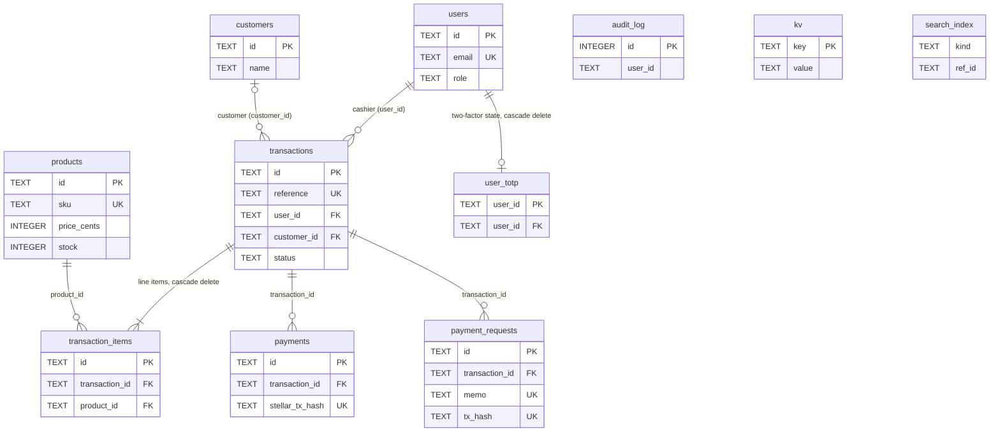

# Database schema

This document describes the SQLite schema used by the StellarPOS backend. It
is derived from the schema code on `main`, not from a migrations folder:

- `SCHEMA` in `src/utils/database.ts` holds every table, index and
  constraint. It is applied idempotently (`CREATE ... IF NOT EXISTS`) on every
  boot by `connectDatabase()`.
- `SEARCH_SCHEMA` in `src/utils/searchIndex.ts` holds the FTS5 search index
  and its sync triggers. It is applied right after `SCHEMA`.

There are no `ALTER` or `DROP` statements. A column that does not appear in
`SCHEMA` or `SEARCH_SCHEMA` is not created by the server.

Connection settings applied by `connectDatabase()`: `foreign_keys = ON`,
`busy_timeout = 5000`, and, for file databases, `journal_mode = WAL` with
`synchronous = NORMAL`.

## Entity relationship diagram

`audit_log`, `kv` and `search_index` have no foreign keys. `audit_log.user_id`
is kept as a plain value so that audit rows survive user changes.
`search_index` is an FTS5 virtual table that refers to rows in other tables
by `ref_id`, and its triggers keep it in sync.

## Tables

Column nullability is written as `NOT NULL` or `NULL`. Defaults are shown as
SQL. Every table created by `SCHEMA` is listed in the order it appears in the
code. Since there are no numbered migrations, the "Created by" column names the
schema block that creates the table.

### users

Created by: `SCHEMA` (`src/utils/database.ts`). Maintained by `UserModel`.

| Column | Type | Nullability | Default | Constraints |
| --- | --- | --- | --- | --- |
| id | TEXT | NOT NULL | none | PRIMARY KEY |
| name | TEXT | NOT NULL | none | |
| email | TEXT | NOT NULL | none | UNIQUE, COLLATE NOCASE |
| password_hash | TEXT | NOT NULL | none | |
| role | TEXT | NOT NULL | none | CHECK in `admin`, `manager`, `cashier` |
| created_at | TEXT | NOT NULL | `datetime('now')` | |

Indexes: the UNIQUE constraint on `email` creates an implicit index.

### products

Created by: `SCHEMA`. Maintained by `ProductModel`.

| Column | Type | Nullability | Default | Constraints |
| --- | --- | --- | --- | --- |
| id | TEXT | NOT NULL | none | PRIMARY KEY |
| name | TEXT | NOT NULL | none | |
| sku | TEXT | NOT NULL | none | UNIQUE, COLLATE NOCASE |
| description | TEXT | NOT NULL | `''` | |
| category | TEXT | NOT NULL | `'General'` | |
| price_cents | INTEGER | NOT NULL | none | CHECK `price_cents >= 0`. Money, see below |
| stock | INTEGER | NOT NULL | `0` | CHECK `stock >= 0` |
| low_stock_threshold | INTEGER | NOT NULL | `5` | |
| active | INTEGER | NOT NULL | `1` | Boolean stored as 0 or 1. Archived products have 0 |
| created_at | TEXT | NOT NULL | `datetime('now')` | |
| updated_at | TEXT | NOT NULL | `datetime('now')` | |

Indexes: the UNIQUE constraint on `sku` creates an implicit index. Product
search goes through `search_index`. Product queries filter by `active`,
`category` and `stock <= low_stock_threshold` without a dedicated index.

### customers

Created by: `SCHEMA`. Maintained by `CustomerModel`.

| Column | Type | Nullability | Default | Constraints |
| --- | --- | --- | --- | --- |
| id | TEXT | NOT NULL | none | PRIMARY KEY |
| name | TEXT | NOT NULL | none | |
| email | TEXT | NULL | none | |
| phone | TEXT | NULL | none | |
| stellar_address | TEXT | NULL | none | |
| notes | TEXT | NOT NULL | `''` | |
| created_at | TEXT | NOT NULL | `datetime('now')` | |

`CustomerModel.delete` sets `transactions.customer_id` to NULL before it
deletes the row, so past sales are kept. This is done in code, not by a
foreign key action.

### transactions

Created by: `SCHEMA`. Maintained by `TransactionModel`.

| Column | Type | Nullability | Default | Constraints |
| --- | --- | --- | --- | --- |
| id | TEXT | NOT NULL | none | PRIMARY KEY |
| reference | TEXT | NOT NULL | none | UNIQUE. Format `S-000001`, from `kv` key `sale_seq` |
| user_id | TEXT | NOT NULL | none | FOREIGN KEY to `users(id)` |
| customer_id | TEXT | NULL | none | FOREIGN KEY to `customers(id)` |
| subtotal_cents | INTEGER | NOT NULL | none | Money |
| discount_cents | INTEGER | NOT NULL | `0` | Money |
| tax_cents | INTEGER | NOT NULL | `0` | Money |
| total_cents | INTEGER | NOT NULL | none | Money |
| status | TEXT | NOT NULL | none | CHECK in `pending`, `completed`, `void`, `refunded` |
| note | TEXT | NOT NULL | `''` | |
| created_at | TEXT | NOT NULL | `datetime('now')` | |
| completed_at | TEXT | NULL | none | |

Indexes:

| Index | Columns | Purpose (from the code comments and queries) |
| --- | --- | --- |
| idx_transactions_created | created_at | Date-range queries |
| idx_transactions_status | status | Filter by status |
| idx_transactions_status_created | status, created_at | Analytics over completed sales by date |
| idx_transactions_customer | customer_id, created_at | Customer sales list |

### transaction_items

Created by: `SCHEMA`. Written inside `TransactionModel.createSale`.

| Column | Type | Nullability | Default | Constraints |
| --- | --- | --- | --- | --- |
| id | TEXT | NOT NULL | none | PRIMARY KEY |
| transaction_id | TEXT | NOT NULL | none | FOREIGN KEY to `transactions(id)`, ON DELETE CASCADE |
| product_id | TEXT | NOT NULL | none | FOREIGN KEY to `products(id)` |
| name | TEXT | NOT NULL | none | Snapshot of the product name at sale time |
| sku | TEXT | NOT NULL | none | Snapshot of the SKU at sale time |
| unit_price_cents | INTEGER | NOT NULL | none | Money. Snapshot of the price at sale time |
| quantity | INTEGER | NOT NULL | none | CHECK `quantity > 0` |
| line_total_cents | INTEGER | NOT NULL | none | Money. `unit_price_cents * quantity` |

Indexes:

| Index | Columns | Purpose |
| --- | --- | --- |
| idx_items_tx | transaction_id | Load items for a sale |
| idx_items_product | product_id | Top products and archive-on-delete checks |

### payments

Created by: `SCHEMA`. Written by `PaymentModel`.

| Column | Type | Nullability | Default | Constraints |
| --- | --- | --- | --- | --- |
| id | TEXT | NOT NULL | none | PRIMARY KEY |
| transaction_id | TEXT | NOT NULL | none | FOREIGN KEY to `transactions(id)` |
| method | TEXT | NOT NULL | none | CHECK in `cash`, `card`, `stellar` |
| amount_cents | INTEGER | NOT NULL | none | Money |
| tendered_cents | INTEGER | NULL | none | Money. Cash given by the customer |
| change_cents | INTEGER | NULL | none | Money. Change returned |
| status | TEXT | NOT NULL | none | CHECK in `pending`, `completed`, `failed` |
| stellar_tx_hash | TEXT | NULL | none | UNIQUE |
| created_at | TEXT | NOT NULL | `datetime('now')` | |

Indexes: `idx_payments_tx` on `transaction_id`. The UNIQUE constraint on
`stellar_tx_hash` creates an implicit index.

### payment_requests

Created by: `SCHEMA`. Written by `PaymentRequestModel`.

| Column | Type | Nullability | Default | Constraints |
| --- | --- | --- | --- | --- |
| id | TEXT | NOT NULL | none | PRIMARY KEY |
| transaction_id | TEXT | NOT NULL | none | FOREIGN KEY to `transactions(id)` |
| destination | TEXT | NOT NULL | none | Stellar account that receives the payment |
| asset_code | TEXT | NOT NULL | none | |
| asset_issuer | TEXT | NULL | none | NULL for native XLM |
| amount | TEXT | NOT NULL | none | Stellar decimal string, up to 7 decimals. See money |
| memo | TEXT | NOT NULL | none | UNIQUE. Used to match the incoming payment |
| uri | TEXT | NOT NULL | none | Payment URI shown to the wallet |
| status | TEXT | NOT NULL | none | CHECK in `pending`, `paid`, `expired`, `cancelled` |
| tx_hash | TEXT | NULL | none | UNIQUE |
| payer | TEXT | NULL | none | |
| expires_at | TEXT | NOT NULL | none | Written by the app as an ISO timestamp |
| paid_at | TEXT | NULL | none | |
| created_at | TEXT | NOT NULL | `datetime('now')` | |

Indexes: `idx_requests_status` on `status`. The UNIQUE constraints on `memo`
and `tx_hash` create implicit indexes.

### audit_log

Created by: `SCHEMA`. Written by `src/middleware/audit.middleware.ts` with a
direct `INSERT`, not through a model.

| Column | Type | Nullability | Default | Constraints |
| --- | --- | --- | --- | --- |
| id | INTEGER | NOT NULL | auto | PRIMARY KEY AUTOINCREMENT |
| user_id | TEXT | NULL | none | No foreign key, by design |
| user_email | TEXT | NULL | none | |
| role | TEXT | NULL | none | |
| action | TEXT | NOT NULL | none | |
| path | TEXT | NOT NULL | none | |
| status | INTEGER | NOT NULL | none | HTTP status code |
| ip | TEXT | NULL | none | |
| created_at | TEXT | NOT NULL | `datetime('now')` | |

Indexes: `idx_audit_created` on `created_at`; `idx_audit_user` on
`user_id, created_at`.

### user_totp

Created by: `SCHEMA`. Written by `TwoFactorModel`.

| Column | Type | Nullability | Default | Constraints |
| --- | --- | --- | --- | --- |
| user_id | TEXT | NOT NULL | none | PRIMARY KEY, FOREIGN KEY to `users(id)`, ON DELETE CASCADE |
| secret_enc | TEXT | NULL | none | Encrypted secret (`utils/secretBox.ts`). Set when 2FA is enabled |
| pending_enc | TEXT | NULL | none | Encrypted secret during enrolment |
| recovery_hashes | TEXT | NOT NULL | `'[]'` | JSON array of SHA-256 hashes of recovery codes |
| last_step | INTEGER | NOT NULL | `0` | Last TOTP time step used, to block replay |
| enabled_at | TEXT | NULL | none | |

### kv

Created by: `SCHEMA`. Generic key and value store.

| Column | Type | Nullability | Default | Constraints |
| --- | --- | --- | --- | --- |
| key | TEXT | NOT NULL | none | PRIMARY KEY |
| value | TEXT | NOT NULL | none | |

Known keys: `sale_seq` (last sale reference number, used by
`TransactionModel`) and the payment watcher cursor (`src/services/paymentWatcher.ts`).

### search_index

Created by: `SEARCH_SCHEMA` (`src/utils/searchIndex.ts`). An FTS5 virtual
table, not a regular table.

| Column | Type | Notes |
| --- | --- | --- |
| kind | UNINDEXED | `product`, `customer` or `sale` |
| ref_id | UNINDEXED | ID of the source row. A sale can have several rows |
| title | indexed | Product name, customer name or sale reference |
| body | indexed | SKU, category and description, contact fields and notes, or sale note and item names |

Tokenizer: `unicode61 remove_diacritics 2`. Triggers keep the index in sync
for `products` (insert, update, delete), `customers` (insert, update,
delete), `transactions` (insert, and update of `note`) and
`transaction_items` (insert). `backfillSearchIndex` fills the index on boot
if it is empty.

## Foreign keys

| From | Column | To | On delete |
| --- | --- | --- | --- |
| transactions | user_id | users(id) | no action (restrict) |
| transactions | customer_id | customers(id) | no action (restrict). Code sets it to NULL first |
| transaction_items | transaction_id | transactions(id) | CASCADE |
| transaction_items | product_id | products(id) | no action (restrict). Products on past sales are archived, not deleted |
| payments | transaction_id | transactions(id) | no action (restrict) |
| payment_requests | transaction_id | transactions(id) | no action (restrict) |
| user_totp | user_id | users(id) | CASCADE |

## Indexes

Explicit indexes, from `SCHEMA`:

- `idx_transactions_created` on `transactions(created_at)`
- `idx_transactions_status` on `transactions(status)`
- `idx_transactions_status_created` on `transactions(status, created_at)`
- `idx_transactions_customer` on `transactions(customer_id, created_at)`
- `idx_items_tx` on `transaction_items(transaction_id)`
- `idx_items_product` on `transaction_items(product_id)`
- `idx_payments_tx` on `payments(transaction_id)`
- `idx_requests_status` on `payment_requests(status)`
- `idx_audit_created` on `audit_log(created_at)`
- `idx_audit_user` on `audit_log(user_id, created_at)`

Implicit indexes come from UNIQUE constraints and the primary keys:
`users.email`, `products.sku`, `transactions.reference`,
`payments.stellar_tx_hash`, `payment_requests.memo`,
`payment_requests.tx_hash`, and every table's primary key.

## Money

| Column | Unit | Stored as |
| --- | --- | --- |
| products.price_cents | store currency, minor units (cents) | INTEGER |
| transactions.subtotal_cents, discount_cents, tax_cents, total_cents | cents | INTEGER |
| transaction_items.unit_price_cents, line_total_cents | cents | INTEGER |
| payments.amount_cents, tendered_cents, change_cents | cents | INTEGER |
| payment_requests.amount | Stellar asset units, decimal string with up to 7 decimals | TEXT |

- Store amounts are integer cents. Floats are never used. Tax is computed
  from `config.store.taxRateBps` (basis points) by `taxCents` in
  `src/utils/money.ts`.
- Stellar amounts are kept as the 7-decimal string that Horizon returns.
  `src/utils/money.ts` converts them to `bigint` stroops at runtime
  (1 unit = 10,000,000 stroops). The database does not store stroops.
- Columns named `*_cents` must hold integers. The CHECK constraints on
  `products.price_cents`, `products.stock` and `transaction_items.quantity`
  enforce the non-negative and positive rules; the other money columns are
  not checked in SQL.
