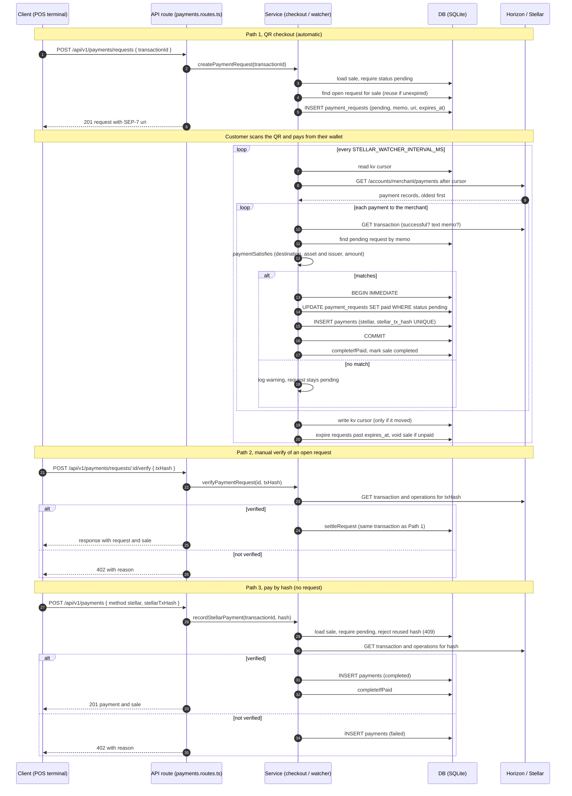

# Stellar payment flow

This page traces a Stellar payment from the moment a cashier opens a checkout
to the moment the sale is completed. It describes what the code does today on
`main`. For the design rationale and threat model, read
[stellar-payments.md](./stellar-payments.md). This page covers the sequence
and the failure states.

Every path ends in the same place: `completeIfPaid` in
[`checkout.service.ts`](../src/services/checkout.service.ts#L48-L60) marks the
sale completed once `paidCents >= totalCents`. Only Horizon's view of the
network can mark a Stellar payment as paid. The client never supplies that
outcome.

There are three ways a Stellar payment reaches a sale:

1. **QR checkout, automatic.** The backend opens a request, the customer pays
   with a memo, and the poller settles it.
2. **QR checkout, manual verify.** The cashier submits the hash for an open
   request.
3. **Pay by hash.** The cashier submits a hash for the sale directly, with no
   request.

## Sequence diagram

## Walkthrough

### 1. Create a QR request

- **Route.** `POST /api/v1/payments/requests` is mounted at
  [`app.ts:78`](../src/app.ts#L78). It is behind `authenticate`
  ([`payments.routes.ts:16`](../src/routes/payments.routes.ts#L16)) and
  `validateBody(createRequestSchema)`
  ([`payments.routes.ts:49-51`](../src/routes/payments.routes.ts#L49-L51),
  schema in [`payment.validation.ts:24`](../src/validation/payment.validation.ts#L24)).
  The route returns `201` with the request.
- **Service.** `createPaymentRequest` in
  [`checkout.service.ts:151`](../src/services/checkout.service.ts#L151).
  - The sale must be `pending` ([`:152`](../src/services/checkout.service.ts#L152),
    checked in `pendingSale` at [`:30-37`](../src/services/checkout.service.ts#L30-L37)).
  - An unexpired open request for the sale is returned instead of a new one
    ([`:154-155`](../src/services/checkout.service.ts#L154-L155)).
  - The memo is `SP` plus 10 random characters
    ([`:161`](../src/services/checkout.service.ts#L161)). Expiry is set from
    `STELLAR_PAYMENT_TTL_MINUTES` ([`:162`](../src/services/checkout.service.ts#L162)).
  - The URI is built by `buildPaymentUri` ([`stellar.service.ts:39-59`](../src/services/stellar.service.ts#L39-L59))
    and the row is written by `PaymentRequestModel.create`
    ([`paymentRequest.model.ts:59-81`](../src/models/paymentRequest.model.ts#L59-L81)).
- **Missing config.** If `STELLAR_MERCHANT_PUBLIC_KEY` is unset, `merchantAccount`
  throws `503` ([`checkout.service.ts:39-45`](../src/services/checkout.service.ts#L39-L45)).

### 2. Poll Horizon for payments

- **Start.** `startPaymentWatcher` is called from [`server.ts:23`](../src/server.ts#L23).
  It does nothing unless `config.stellar.watcher.enabled` is set and the merchant key
  exists ([`paymentWatcher.ts:48-53`](../src/services/paymentWatcher.ts#L48-L53)).
- **Tick.** A `running` flag prevents overlapping polls
  ([`paymentWatcher.ts:54-57`](../src/services/paymentWatcher.ts#L54-L57)).
  The first tick runs immediately, then on an interval
  ([`:66-67`](../src/services/paymentWatcher.ts#L66-L67)).
- **Cursor.** `pollOnce` reads the cursor from the `kv` table
  ([`paymentWatcher.ts:15-19`](../src/services/paymentWatcher.ts#L15-L19),
  [`:31`](../src/services/paymentWatcher.ts#L31)). On the first run it starts from
  the latest payment and skips history ([`:32-35`](../src/services/paymentWatcher.ts#L32-L35)).
- **Fetch.** `fetchPaymentsSince` calls
  `/accounts/{merchant}/payments` in ascending order
  ([`horizon.ts:74-92`](../src/services/horizon.ts#L74-L92)).
  `normalize` keeps only `payment` and both path-payment types
  ([`horizon.ts:58-71`](../src/services/horizon.ts#L58-L71), type filter on
  line 59), drops transactions that failed (line 60), and reports the asset that
  was received, which is the destination asset for path payments (lines 68-69).

### 3. Match and settle an incoming payment

- **Per payment.** `pollOnce` calls `handleIncomingPayment` for each payment
  ([`paymentWatcher.ts:38-40`](../src/services/paymentWatcher.ts#L38-L40)).
- **Transaction check.** `handleIncomingPayment` fetches the transaction and
  requires `successful` and a `text` memo
  ([`checkout.service.ts:237-239`](../src/services/checkout.service.ts#L237-L239),
  Horizon call in [`horizon.ts:100-115`](../src/services/horizon.ts#L100-L115)).
- **Match.** It looks up a `pending` request by memo
  ([`checkout.service.ts:241-242`](../src/services/checkout.service.ts#L241-L242),
  [`paymentRequest.model.ts:89-94`](../src/models/paymentRequest.model.ts#L89-L94)).
  Unknown memos are ignored.
- **Verify the payment.** `paymentSatisfies` checks destination, asset code and
  issuer, and amount in stroops
  ([`checkout.service.ts:244-249`](../src/services/checkout.service.ts#L244-L249),
  [`stellar.service.ts:83-89`](../src/services/stellar.service.ts#L83-L89)).
  On a mismatch the function logs a warning and returns `false`
  ([`checkout.service.ts:249-254`](../src/services/checkout.service.ts#L249-L254)).
- **Settle.** `settleRequest` runs in `withTransaction`
  ([`checkout.service.ts:183-195`](../src/services/checkout.service.ts#L183-L195),
  `BEGIN IMMEDIATE` at [`database.ts:189`](../src/utils/database.ts#L189),
  `COMMIT` at [`:192`](../src/utils/database.ts#L192),
  `ROLLBACK` at [`:195`](../src/utils/database.ts#L195)). Inside it:
  - `markPaid` updates the request only if it is still `pending`
    ([`paymentRequest.model.ts:112-121`](../src/models/paymentRequest.model.ts#L112-L121),
    called at [`checkout.service.ts:185`](../src/services/checkout.service.ts#L185)).
  - `PaymentModel.create` inserts a completed `stellar` payment with the tx hash
    ([`checkout.service.ts:187-193`](../src/services/checkout.service.ts#L187-L193)).
    `payments.stellar_tx_hash` is `UNIQUE` ([`database.ts:91`](../src/utils/database.ts#L91)).
- **Complete the sale.** `completeIfPaid` runs after the commit
  ([`checkout.service.ts:196`](../src/services/checkout.service.ts#L196),
  body at [`:48-60`](../src/services/checkout.service.ts#L48-L60)). It emits
  `transaction:completed` ([`:53`](../src/services/checkout.service.ts#L53)),
  `analytics:updated`, and low-stock alerts.
- **Notify.** `payment:confirmed` is emitted with the request and sale
  ([`checkout.service.ts:197-203`](../src/services/checkout.service.ts#L197-L203)).
- **Cursor.** The cursor is written only if it moved
  ([`paymentWatcher.ts:41`](../src/services/paymentWatcher.ts#L41)).

### 4. Manual verify of an open request

- **Route.** `POST /requests/:id/verify`
  ([`payments.routes.ts:66-72`](../src/routes/payments.routes.ts#L66-L72)).
- **Service.** `verifyPaymentRequest`
  ([`checkout.service.ts:208-230`](../src/services/checkout.service.ts#L208-L230)).
  - An already paid request returns early with no new work
    ([`:214-216`](../src/services/checkout.service.ts#L214-L216)).
  - A non-pending request returns `409` ([`:217`](../src/services/checkout.service.ts#L217)).
  - `verifyPayment` checks the hash, the transaction, the memo, and the payment
    operations ([`stellar.service.ts:97-120`](../src/services/stellar.service.ts#L97-L120)).
  - A failed check returns `402` ([`checkout.service.ts:225-226`](../src/services/checkout.service.ts#L225-L226)).
    No row is written.
  - A passed check calls `settleRequest` ([`:228`](../src/services/checkout.service.ts#L228)),
    the same code as step 3.

### 5. Pay by hash

- **Route.** `POST /api/v1/payments` with `method: "stellar"` and
  `stellarTxHash`. `stellarTxHash` is required for `stellar` and forbidden
  otherwise ([`payment.validation.ts:10-20`](../src/validation/payment.validation.ts#L10-L20)).
  The route dispatches at [`payments.routes.ts:37-43`](../src/routes/payments.routes.ts#L37-L43)
  and returns `201`.
- **Service.** `recordStellarPayment`
  ([`checkout.service.ts:119-145`](../src/services/checkout.service.ts#L119-L145)).
  - The sale must be `pending` ([`:123`](../src/services/checkout.service.ts#L123)).
  - A hash already on a payment returns `409` ([`:124-126`](../src/services/checkout.service.ts#L124-L126)).
  - `verifyPayment` runs against the sale's current balance, with no memo check
    (`expectedFor`, [`:105-112`](../src/services/checkout.service.ts#L105-L112)).
  - On failure it writes a `failed` payment row
    ([`:129-134`](../src/services/checkout.service.ts#L129-L134)) and throws `402`
    ([`:135`](../src/services/checkout.service.ts#L135)).
  - On success it writes a completed payment and calls `completeIfPaid`
    ([`:137-144`](../src/services/checkout.service.ts#L137-L144)).

### 6. Verification against Horizon

`verifyPayment` in [`stellar.service.ts:97-120`](../src/services/stellar.service.ts#L97-L120)
applies these checks in order:

1. The hash is 64 hex characters ([`:98`](../src/services/stellar.service.ts#L98)).
2. The transaction exists ([`:101-102`](../src/services/stellar.service.ts#L101-L102)).
3. The transaction is successful ([`:103`](../src/services/stellar.service.ts#L103)).
4. The memo matches, when an expected memo is given ([`:104-106`](../src/services/stellar.service.ts#L104-L106)).
5. A payment matches destination, asset, and amount
   ([`:108-109`](../src/services/stellar.service.ts#L108-L109)).

### 7. Expiry and cancel

- **Expiry.** `expireStaleRequests` runs at the end of every poll
  ([`paymentWatcher.ts:42`](../src/services/paymentWatcher.ts#L42)). It sets
  each expired request to `expired`
  ([`checkout.service.ts:271-278`](../src/services/checkout.service.ts#L271-L278),
  [`paymentRequest.model.ts:105-110`](../src/models/paymentRequest.model.ts#L105-L110)).
  If the sale is still pending and has no payments, the sale is voided
  ([`:276`](../src/services/checkout.service.ts#L276)). It emits `payment:expired`
  ([`:277`](../src/services/checkout.service.ts#L277)).
- **Cancel.** `POST /requests/:id/cancel` sets the request to `cancelled`
  ([`checkout.service.ts:259-265`](../src/services/checkout.service.ts#L259-L265),
  route at [`payments.routes.ts:74-79`](../src/routes/payments.routes.ts#L74-L79)).
  It does not void the sale.

## Failure states

| State | Trigger and location | What happens |
|---|---|---|
| Invalid body | Joi validation fails, for example a non-hex hash for `stellar` or a missing `transactionId`. [`payment.validation.ts:10-20`](../src/validation/payment.validation.ts#L10-L20) | Rejected by `validateBody` before the service runs. Nothing is written. |
| Sale not pending | `pendingSale` finds a non-pending sale. [`checkout.service.ts:33-35`](../src/services/checkout.service.ts#L33-L35) | `409`. Nothing is written. |
| Stellar not configured | `STELLAR_MERCHANT_PUBLIC_KEY` is unset. [`checkout.service.ts:39-45`](../src/services/checkout.service.ts#L39-L45) | `503`. In pay-by-hash, no row is written, because `expectedFor` runs before any insert. |
| Hash already used | `findByStellarHash` finds a payment. [`checkout.service.ts:124-126`](../src/services/checkout.service.ts#L124-L126) | `409`. No new row. |
| Verification fails (pay by hash) | `verifyPayment` returns `verified: false`. [`checkout.service.ts:127-135`](../src/services/checkout.service.ts#L127-L135) | A `failed` payment row is written as an audit trail, and the response is `402` with the reason from [`stellar.service.ts:98-118`](../src/services/stellar.service.ts#L98-L118). |
| Verification fails (manual verify) | Same check, on a request. [`checkout.service.ts:225-226`](../src/services/checkout.service.ts#L225-L226) | `402`. No row is written and the request stays pending. |
| Failed on-chain transaction | `successful` is false, so `normalize` drops the operation and `verifyPayment` rejects it. [`horizon.ts:60`](../src/services/horizon.ts#L60), [`stellar.service.ts:103`](../src/services/stellar.service.ts#L103), [`checkout.service.ts:239`](../src/services/checkout.service.ts#L239) | Ignored by the poller. Rejected by the verify paths. |
| Memo missing, not text, or unknown | [`checkout.service.ts:239`](../src/services/checkout.service.ts#L239), [`:241-242`](../src/services/checkout.service.ts#L241-L242) | Ignored silently. The account may receive unrelated payments. |
| Underpayment or wrong asset or destination on a QR request | `paymentSatisfies` returns false. [`checkout.service.ts:249-254`](../src/services/checkout.service.ts#L249-L254) | A warning is logged. The request stays pending and no failed row is written. The customer can pay again until expiry. |
| Overpayment | `paymentSatisfies` accepts `amount >= requested`. | Settles at the sale's balance. The excess on-chain is not recorded as change. [`checkout.service.ts:137-140`](../src/services/checkout.service.ts#L137-L140) |
| Horizon error during verify or pay by hash | `fetchTransaction` rethrows anything other than not-found. [`horizon.ts:111-114`](../src/services/horizon.ts#L111-L114) | The error propagates to the route. No payment row is written. |
| Horizon error during poll | Any throw in `pollOnce`. [`paymentWatcher.ts:59-62`](../src/services/paymentWatcher.ts#L59-L62) | Logged as a warning. The cursor is not written, so the next tick re-reads the same records. Settlement is idempotent, so the replay is harmless. |
| Duplicate or replayed Horizon record | `markPaid` only updates a `pending` row, and `findPendingByMemo` skips paid requests. [`paymentRequest.model.ts:112-121`](../src/models/paymentRequest.model.ts#L112-L121), [`:89-94`](../src/models/paymentRequest.model.ts#L89-L94) | No second payment is recorded. |
| Request expires before payment | `expireStaleRequests`. [`checkout.service.ts:271-280`](../src/services/checkout.service.ts#L271-L280) | Request becomes `expired`. The sale is voided if unpaid. A payment that arrives in the same poll, before expiry runs, still settles. |
| Payment arrives after expiry or cancel | `findPendingByMemo` requires `pending`. [`paymentRequest.model.ts:89-94`](../src/models/paymentRequest.model.ts#L89-L94) | The poller does not match it. Pay by hash fails because the sale is no longer pending. The code has no refund, alert, or reconciliation path for this case. This is a gap. |
| Watcher disabled | `config.stellar.watcher.enabled` is off or the merchant key is missing. [`paymentWatcher.ts:50-53`](../src/services/paymentWatcher.ts#L50-L53) | Requests can still be created. Nothing settles automatically, so cashiers must use manual verify or pay by hash. |

## Open items

These are not confirmed from the code read for this page. See
`NOTES.md` in the same working folder.

- What `TransactionModel.void` does to stock, and the exact status string
  `pendingSale` sees for a voided sale.
- The exact rounding in `centsToAssetAmount` (`utils/money.ts`), and the memo
  alphabet in `randomToken` (`utils/helpers.ts`).
- The HTTP status for non-`AppError` Horizon failures (`middleware/error.middleware.ts`).
- The `verifyRequestSchema` body rules (`validation/payment.validation.ts` line 28 onward).
- Any settlement path through the Soroban `payment-processor` in the contracts repo.
  It is not in this repo.
